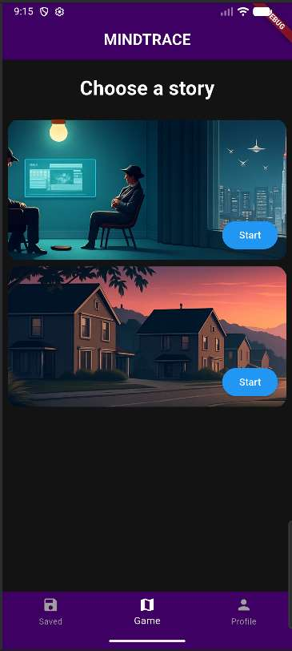
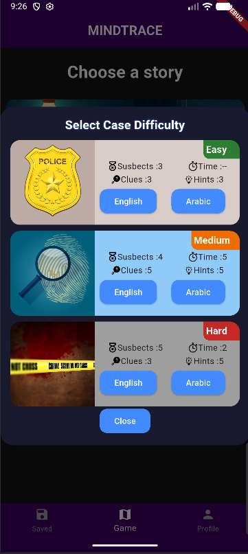
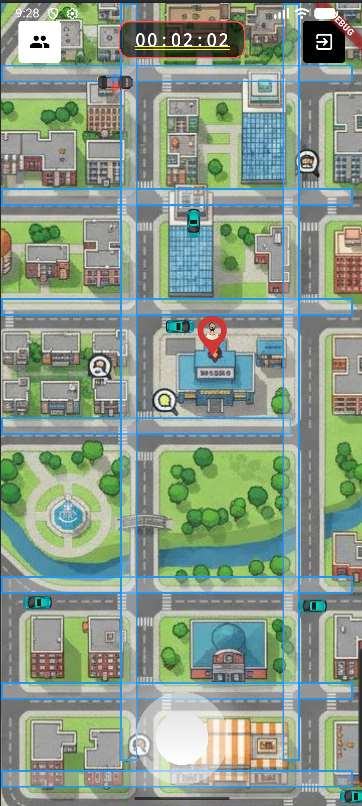
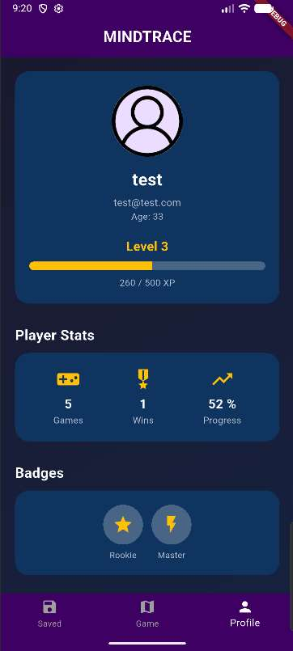

# MindTrace 🕵️

**An AI-powered detective game built with Flutter.**

MindTrace puts the player in the role of an investigator solving a murder case. Each case — the story, victim, suspects, clues and hidden killer — is generated by the OpenAI GPT API, and the player interrogates suspects in a live chat where every answer is generated in real time. No two cases play the same.

Final year project — Department of Computer Science, Faculty of Computing and Information, Al-Baha University (2025–2026).

## Screenshots

| Login | Choose a story | Difficulty | City map |
|---|---|---|---|
|  |  |  |  |

| Suspects | Interrogation | Case solved | Player profile |
|---|---|---|---|
|  |  |  |  |

## Features

- **AI-generated cases** — GPT builds a full mystery (victim, suspects with motives and alibis, clues, killer) for each new game.
- **Live interrogation** — chat with suspects and the victim's file; replies are context-aware and generated on the fly.
- **Three difficulty levels** — Easy / Medium / Hard change the number of suspects, clues, hints and the time limit.
- **Explorable city map** — drive around with a joystick, enter houses and search rooms for clues.
- **Countdown timer** — solve the case before investigation time runs out.
- **Arabic & English** — every case can be played in either language.
- **Save & resume** — games, clues and chat history are stored locally in SQLite.
- **Player progression** — levels, XP, stats and badges.

## Tech stack

| Area | Tools |
|---|---|
| App | Flutter / Dart |
| AI | OpenAI GPT (Chat Completions API) |
| Local storage | SQLite (`sqflite`), `shared_preferences` |
| Gameplay | `flutter_joystick`, `just_audio`, `animated_text_kit` |
| Answer matching | `string_similarity` |

## Project structure

```
lib/
├── main.dart
├── Models/      # data models (user, clue, suspect, chat message)
├── screens/     # login, home, lobby, play_game, chat, inventory, profile, saved games
├── services/    # chat_service — OpenAI requests
├── utils/       # SQLite helper, helpers, strings
└── widgets/     # map scene, moving car, night overlay, progress painters
assets/
├── images/
└── sounds/
```

## Getting started

```bash
git clone https://github.com/<your-username>/MindTrace.git
cd MindTrace
flutter pub get
flutter run --dart-define=OPENAI_API_KEY=your_openai_key
```

Requires Flutter SDK 3.6+ and an Android or iOS device/emulator. You need your own [OpenAI API key](https://platform.openai.com/api-keys) — it is passed at run time and never stored in the repository.

## Team

- Malath Muhammad Al-Harthy
- Aseel Dhaif Allah Al-Ghamdi
- Wesam Abdul Aziz Al-Ghamdi
- Ahmadia Mansi Al-Muntashari

Supervised by **Dr. Adel Al-Harthy**.
